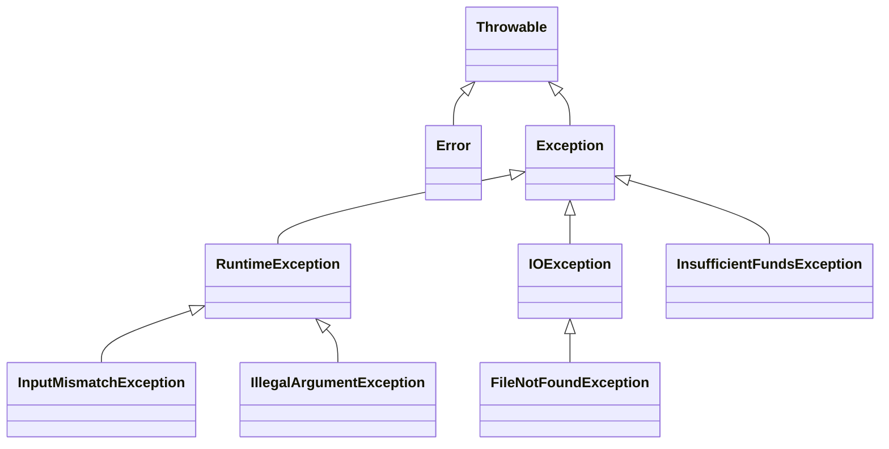

# Q1 — ATM withdrawal failure handling

## Shared / Joint

- `AtmDemo` separates parsing, validation, and withdrawal. It demonstrates valid input, nonnumeric text, a negative amount, insufficient balance, integer overflow, and an absent card file.
- `InputMismatchException` and `IllegalArgumentException` are unchecked. `InsufficientFundsException` and `FileNotFoundException` are checked. `OutOfMemoryError` is an `Error`, not an ordinary transaction failure; the example is classified, never deliberately triggered.
- A single `catch (Exception e)` is acceptable only at a true application boundary that can log and translate arbitrary failures. It hides distinct recovery actions, makes programming errors look like expected input failures, and can accidentally swallow errors if widened to `Throwable`.
- Alternative: `hasNextInt()` can validate console input without exception-driven flow; return `-1` for invalid input. That needs explicit checks at each boundary, but is clearer for expected invalid input. See `results.csv` for measured throw-vs-code timings; throwing also captures a stack and allocates an exception.

## Student A

| Failure point | Exception | Category | Handling site |
|---|---|---|---|
| Text is not an integer / integer overflow | `InputMismatchException` (wraps parse failure) | Unchecked | input multi-catch |
| Negative withdrawal | `IllegalArgumentException` | Unchecked | input multi-catch |
| Amount exceeds balance | `InsufficientFundsException` | Checked | insufficient-funds catch |
| Card file absent | `FileNotFoundException` | Checked | card-read catch |
| VM cannot allocate memory | `OutOfMemoryError` | Error | not caught as a routine ATM failure |

The narrow, expected input cases are caught before the general `RuntimeException`; the checked domain exception is handled separately. The multi-catch alternatives are unrelated sibling types. `finally` runs for normal return and handled exceptions, so cleanup/logging is performed; it cannot guarantee completion after process termination, VM failure, or forced termination.

## Student B

| Input / condition | Result |
|---|---|
| `30` with balance 100 | Approved, balance 70 |
| `abc` | Input mismatch path |
| `-5` | Illegal-argument path |
| `101` | Checked insufficient-funds path |
| Very large integer text | Parse overflow / input mismatch |
| Missing card path | Checked file-open failure |

| Test path | Catch block hit | Finally executed |
|---|---|---|
| Valid withdrawal | None | Yes |
| Nonnumeric / overflow | `InputMismatchException` multi-catch | Yes |
| Negative amount | `IllegalArgumentException` multi-catch | Yes |
| Insufficient balance | `InsufficientFundsException` | Yes |
| Missing card | `FileNotFoundException` | Yes |

Run `java AtmDemo uncaught` to save a real uncaught stack trace in `uncaught-stack.txt`. Read it top to bottom: the exception type/message identifies the failure; the first `AtmDemo` frame is the throw site; following frames show its callers; runtime frames (if any) describe library dispatch. The ordinary run catches expected failures and always prints transaction cleanup.

The deliberately invalid broad-before-narrow example is `compiler-demo/BadCatchOrder.java`; compiling it produces `exception IOException has already been caught`. `compiler-error.txt` preserves the compiler diagnostic. Catching `Exception` first makes the later `IOException` catch unreachable.
