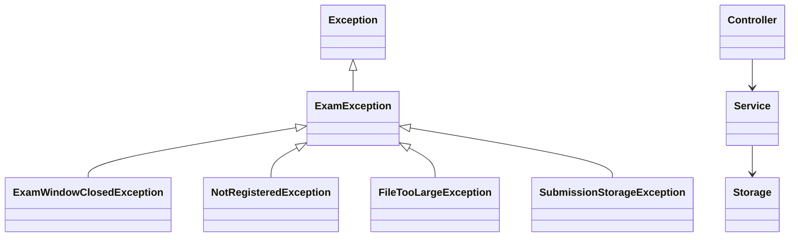

# Q2 — Online exam portal exceptions

## Shared / Joint

`ExamException` is the checked domain root. `ExamWindowClosedException`, `NotRegisteredException`, `FileTooLargeException`, and `SubmissionStorageException` are checked because submission cannot proceed and callers should handle/translate these expected business or infrastructure failures. `IOException` is retained as the storage exception's cause. Controller → service → storage propagation is implemented in `ExamDemo`.

`SubmissionStorageException` is better than exposing `IOException` to a UI because it expresses the action and file that failed, permits storage changes without a UI contract change, and retains the low-level cause for diagnostics.

The `StorageDemo exact-output section` in `output.txt` is exactly:

```text
Saved answer01.pdf
Error: Could not store answer02.pdf
Cause: Disk quota exceeded
```

If the cause is omitted, `getCause()` is null; dereferencing `getCause().getMessage()` throws `NullPointerException`, demonstrated immediately afterward.

## Student A



Propagation example: storage catches `IOException("Disk quota exceeded")` and throws `SubmissionStorageException("Could not store answer02.pdf", cause)`. Service declares `throws ExamException` and lets it propagate. Controller catches the domain type, shows the student `Could not store answer02.pdf`, and logs/retains the cause for support. Checked types force each layer to declare or handle the failure.

## Student B

| Scenario | Expected typed result |
|---|---|
| Closed exam window | `ExamWindowClosedException` |
| Unregistered student | `NotRegisteredException` |
| Submission > 10 MB | `FileTooLargeException` |
| Disk quota exhausted | `SubmissionStorageException`, cause `IOException` |

The saved stack trace includes a `Caused by: java.io.IOException: Disk quota exceeded` section. Re-throwing with only a message loses the original exception type, stack, and causal relationship. The unchecked alternative changes `ExamException` to extend `RuntimeException`:

```java
class ExamException extends RuntimeException { /* same message/cause constructors */ }
void submit(...) { storage.save(...); }   // no throws ExamException
controller.handle(...);                  // catch is optional to compile, but retain it for UI translation
```

The 1/8/32-frame capture benchmark is in `results.csv`; chaining retains the cause object and its stack, increasing reachable memory in proportion to trace depth and retained causes.
