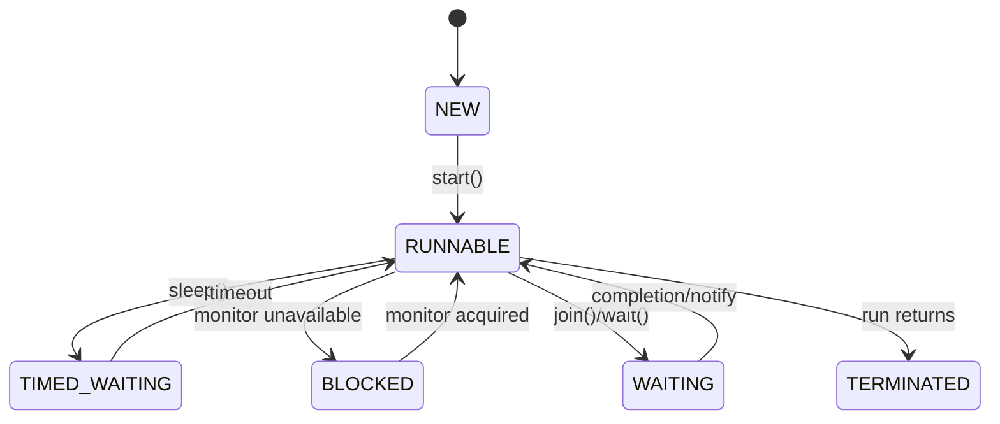

# Q4 — Thread creation and lifecycle

## Shared / Joint

Four answer-scanning stations run both as `Thread` subclasses and as `Runnable` tasks. The ten observed finish orders are recorded in `results.csv`. Scheduling, start timing, and sleep durations vary, so order is nondeterministic; correctness must be based on shared-state synchronization and `join()`/`Future` completion, never print order.

## Student A

`Thread` is useful when specializing thread behavior, but consumes the single inheritance slot. `Runnable` separates the unit of work from execution policy and is preferred for pools/reuse. The demo calls `join()` on every station before printing the finish order; without it, main could report partial completion.

Observed stations report `NEW` before `start()`, `RUNNABLE` when executing, `TIMED_WAITING` during sleep, and `TERMINATED` after `join()`. `BLOCKED` requires monitor contention and `WAITING` can be observed while joining. Calling `run()` directly prints `main`, proving it is an ordinary method call rather than a new thread.

## Student B

Ten actual run orders are in `results.csv`. The station with maximum priority is not guaranteed to finish first; priority is only a scheduler hint. The daemon was not joined and happened to finish before main in this run; that timing is not guaranteed, so daemon work must not be used for required tasks. A two-worker pool processes four 10 ms tasks in approximately two waves; ten measured elapsed times, with average/min/max, are in `results.csv`. Each platform thread reserves native stack space influenced by `-Xss`; pools bound thread/stack use versus one thread per task.

## Shared / Joint alternative

`ExecutorService` with a fixed pool is shown using four `Runnable` stations and `Future.get()`. It separates tasks from threads and bounds concurrency.
