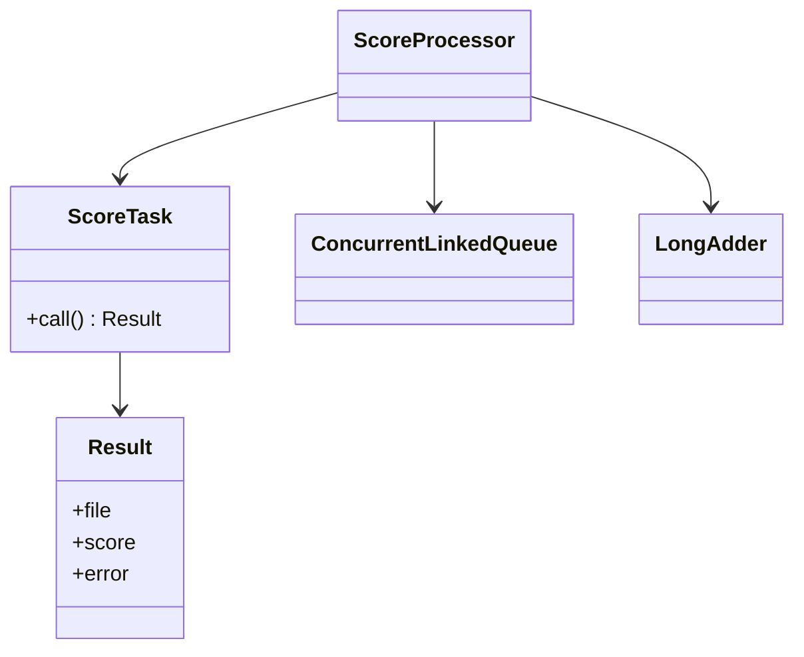

# Q7 — Concurrent fault-tolerant result processor

## Stage 1 — Shared / Joint

Each file is independent work; task results and counters are shared. Missing files and I/O failures become `io-or-missing`, malformed scores become `corrupt-content`, and values outside 0..100 become `out-of-range`. The acceptance invariant is `success + failure = submitted file paths`; every future is consumed even when a worker throws. A practical time threshold is hardware- and storage-dependent, so this run reports measurements rather than claiming a universal X-second guarantee.

## Stage 2 — Student A

`ScoreTask implements Callable<Result>`. Each task handles expected file/content failures and returns a typed result. The coordinator stores results in `ConcurrentLinkedQueue`, uses `LongAdder` counters, calls `Future.get()` for every task, and records unexpected `ExecutionException` as a failed item. This keeps one failed task from terminating the batch.

Pseudocode: create a bounded pool; submit one callable per expected path; for each future, `get`, append the result, and increment success/failure; handle `ExecutionException` as a task failure; assert totals equal submitted tasks; write summary and detail CSVs.

## Stage 3 — Student B

The Java program is the reproducible generator: 10,000 score paths with 100 missing, 100 corrupt, and 100 out-of-range. `small-check.csv` records the separately checked first 20 paths: 17 successes and 3 failures. Ten measured rounds for 1, 2, 4, and 8 worker threads, raw times, and mean/min/max are in `results.csv`; `report.md` includes a chart. No unhandled failures were reported.

## Stage 4 — Shared / Joint

Use the pool size whose observed latency and resource limits best fit deployment; in this run 8 workers are fastest on average. Oversubscription can lose to disk throughput, filesystem cache, context switching, and CPU/core limits. Every expected path is submitted and every future consumed; the summary reconciliation prevents silent drops. Limitation: the example uses local files and stores all results in memory; a streaming/remote production pipeline needs backpressure and durable checkpoints.

## Shared / Joint alternative

`parallelStream()` simplifies CPU-friendly bulk transformations but complicates failure isolation and executor control. Thread-per-file creates up to 10,000 native threads (stack reservation roughly thread count × `-Xss`, before other overhead) and risks `OutOfMemoryError` / inability to create native thread. The fixed pool bounds threads and converts exceptions into per-file results.
