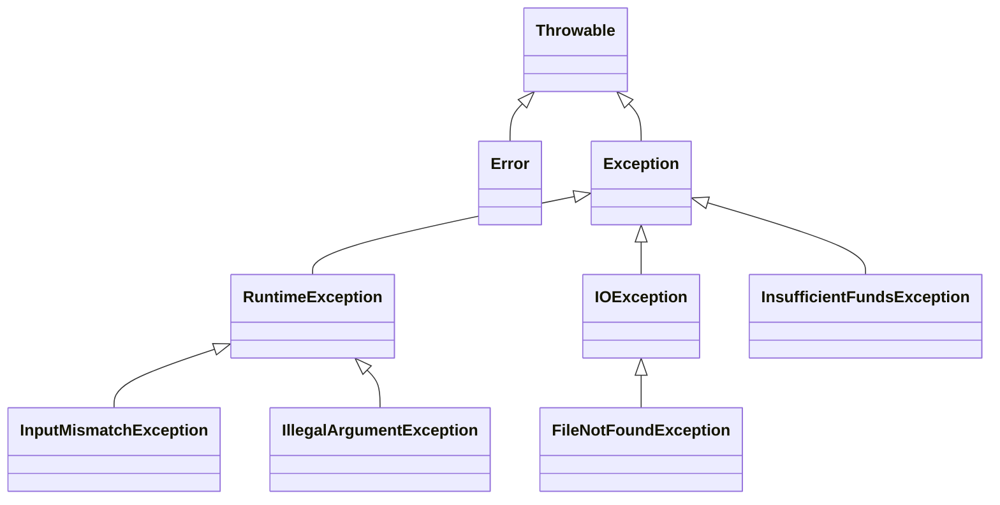
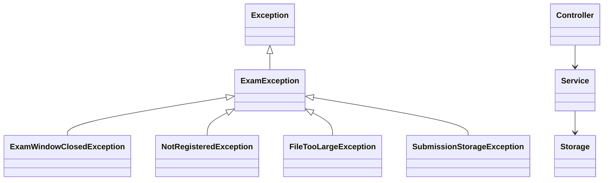
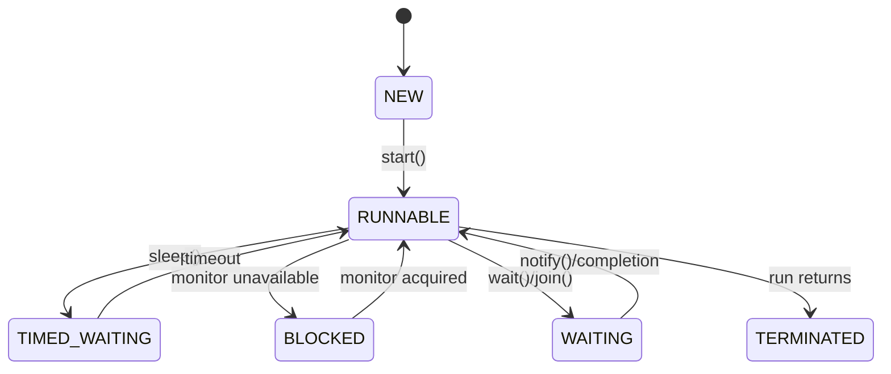
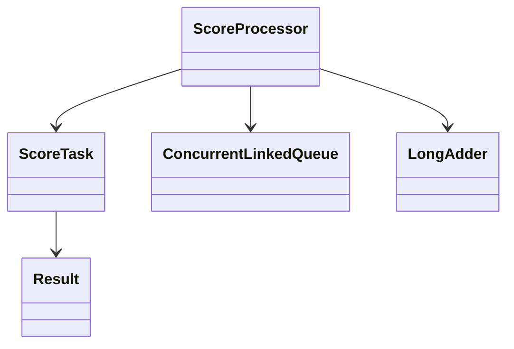
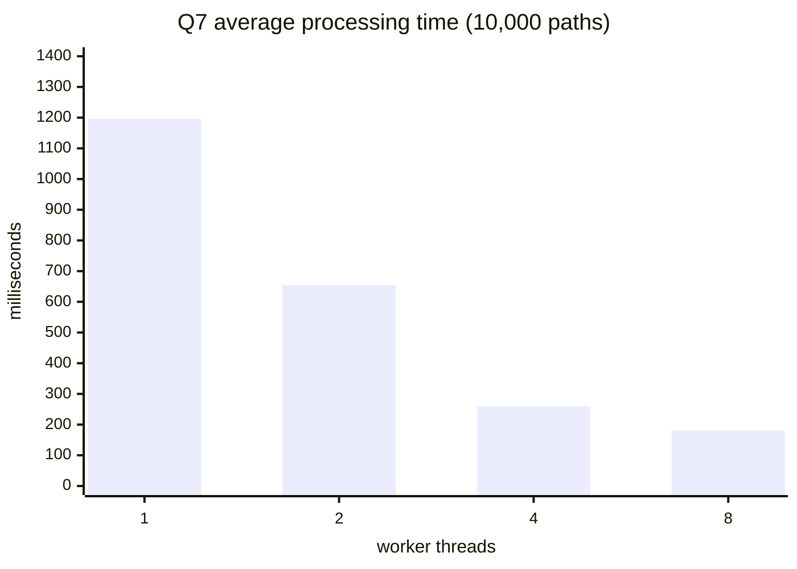

# Assignment 3 (CO3): Exception handling and multithreading

The runnable source files, per-question notes, captured console output, and raw measurements are in `Q1`–`Q7`. Measurements are from the current Windows/JDK 27 run using programs compiled with `javac --release 17`; timings are noisy, machine-specific observations, not universal claims. Each benchmark warms up and records ten measured rounds.

## Q1 — ATM withdrawal failure handling

### Shared / Joint

`AtmDemo` separates amount parsing from business validation and withdrawal. Test paths include valid withdrawal, nonnumeric input, negative value, insufficient balance, integer overflow, and missing card file. `finally` runs on normal completion and caught failures to finish transaction cleanup; it cannot protect against process termination or VM failure.

| Failure point | Exception / category | Catch or disposition |
|---|---|---|
| Non-integer or numeric overflow | `InputMismatchException`, unchecked | Input multi-catch |
| Negative withdrawal | `IllegalArgumentException`, unchecked | Input multi-catch |
| Insufficient balance | `InsufficientFundsException`, checked | Domain-specific catch |
| Missing card file | `FileNotFoundException`, checked | File-read catch |
| VM memory exhaustion | `OutOfMemoryError`, Error | Not treated as a routine transaction error |

Catch expected narrow cases before a general runtime catch. `InputMismatchException` and `IllegalArgumentException` are sibling alternatives suitable for one multi-catch. A single `catch (Exception e)` is reasonable only at a boundary that deliberately logs and translates unknown exceptions; otherwise it hides distinct recovery paths and can turn programming bugs into ordinary input errors. Widening to `Throwable` also catches `Error`s that should generally not be handled as normal input.

### Student A



The hierarchy and catch locations are above. Specific catches precede broad catches because Java tests them in order and a broad catch first makes a later narrower catch unreachable. The intentionally bad example fails compilation with:

```text
Q1\compiler-demo\BadCatchOrder.java:9: error: exception IOException has already been caught
        } catch (IOException narrow) {
          ^
1 error
```

The full diagnostic is retained in `Q1/compiler-error.txt`.

### Student B

| Test input / event | Actual result |
|---|---|
| `30` (balance 100) | Approved; balance 70 |
| `abc` | Input error: amount must be an integer |
| `-5` | Input error: amount must not be negative |
| `101` | Declined: insufficient funds |
| `999999999999999999` | Input error: amount must be an integer |
| Missing card file | Checked `FileNotFoundException` path |

| Test path | Catch block hit | Finally executed |
|---|---|---|
| Valid withdrawal | None | Yes |
| Nonnumeric / overflow | `InputMismatchException` multi-catch | Yes |
| Negative amount | `IllegalArgumentException` multi-catch | Yes |
| Insufficient balance | `InsufficientFundsException` | Yes |
| Missing card | `FileNotFoundException` | Yes |

The deliberately uncaught `IllegalStateException` is saved in `Q1/uncaught-stack.txt`:

```text
Exception in thread "main" java.lang.IllegalStateException: simulated unrecoverable card-reader state
    at AtmDemo.uncaughtExample(AtmDemo.java:38)
    at AtmDemo.main(AtmDemo.java:99)
```

Line by line: the first line gives the uncaught type and message; `uncaughtExample` is where it was thrown; `main` is the caller that allowed it to escape. Run `java AtmDemo uncaught` to reproduce it. In ordinary paths the catch table handles expected failures and `finally` prints cleanup.

### Alternative and measurement

For expected invalid input, `hasNextInt()` or explicit parse validation with an error return (for example `-1`) avoids exception-driven control flow. Return codes require callers to check every result and document the sentinel; exceptions keep the normal success path direct. Stack creation/allocation means exception cost includes more than the validation itself; timing does not measure retained memory or console stack printing.

| 10-round measurement | Average ns/op | Min | Max |
|---|---:|---:|---:|
| Throw/catch | 3,459.1 | 2,163.4 | 5,376.6 |
| Error code | 37.1 | 12.9 | 112.8 |

Raw rounds and summaries: `Q1/results.csv`.

## Q2 — Online exam portal, user-defined exceptions and propagation

### Shared / Joint

`ExamException` and the four named portal failures are checked domain exceptions. Closed exam window, registration, size-policy, and storage failures are expected conditions that the controller must translate. `SubmissionStorageException` preserves the low-level `IOException` as its cause.



The exact `StorageDemo` result block is:

```text
Saved answer01.pdf
Error: Could not store answer02.pdf
Cause: Disk quota exceeded
```

If the constructor receives no cause, `getCause()` is null. Calling `getCause().getMessage()` then throws `NullPointerException`; the program demonstrates this without crashing the normal run.

### Student A

Storage catches `IOException("Disk quota exceeded")` and throws `SubmissionStorageException("Could not store answer02.pdf", cause)`. Service declares `throws ExamException` and lets it propagate. Controller handles the domain failure and shows `Could not store answer02.pdf`; diagnostics retain the cause. The UI can depend on stable exam-domain terms instead of `IOException` or a particular storage backend.

### Student B

| Scenario | Typed outcome |
|---|---|
| Exam closed | `ExamWindowClosedException` |
| Student not registered | `NotRegisteredException` |
| File larger than 10 MB | `FileTooLargeException` |
| Disk quota exhausted | `SubmissionStorageException` caused by `IOException` |

`Q2/output.txt` contains the complete chained trace, including `Caused by: java.io.IOException: Disk quota exceeded`. Re-throwing only a message loses original type, stack location, and causal relationship. If these classes extend `RuntimeException`, remove `throws` declarations and callers' mandatory catches; keep explicit controller handling so the user still receives a useful message.

### Unchecked alternative / measurement

The benchmark creates exceptions at call depths 1, 8, and 32. Average stack-capture time grows with depth in this run. Chaining keeps the cause object and its stack reachable, so retained memory rises with trace depth and number of retained causes.

| Stack depth | Average ns/op | Min | Max |
|---:|---:|---:|---:|
| 1 | 3,441.9 | 2,514.5 | 5,178.2 |
| 8 | 7,271.4 | 5,367.6 | 10,221.5 |
| 32 | 18,274.3 | 14,982.0 | 26,163.5 |

Raw rounds: `Q2/results.csv`.

## Q3 — Daily sales report: resource safety and debugging

### Shared / Joint

The good two-store manual-finally and TWR runs produce identical reports (total 200). The failing list reaches invalid `bad.csv` after opening earlier resources. With the intentionally broken manual-close path, tracked resources show **2 opened / 0 closed**; TWR shows **2 opened / 2 closed**. The report writer is also closed in the manual outer `finally`. The leak is intentionally controlled and process-local.

| Version / run | Readers opened | Readers closed | Leaked readers |
|---|---:|---:|---:|
| Manual, failure before close | 2 | 0 | 2 |
| Try-with-resources, same failure | 2 | 2 | 0 |

TWR alone does not roll back a partially written output, retry a failed write, make a resource atomic, close non-`AutoCloseable` resources, or manage resources escaping across threads. Use a temporary output and atomic replace when partial reports must not be published.

### Student A

`java.util.logging` names `bad.csv` and records the parse failure stack. Debugger instructions: set a breakpoint at the `Integer.parseInt` in `ReportDemo.parse`; run `ReportDemo`; inspect `file`, `row`, `parts`, and `opened`; step into/out of the failing parse and follow the log catch; compare `opened`/`closed` at manual and TWR call sites. **Screenshot placeholder:** insert a VS Code debugger screenshot here; none was available from this command-line run.

### Student B

Each input reader and the output writer must be closed. Multiple TWR resources close in reverse declaration order. Manual close in `finally` is necessary; nested `try` is needed to attempt every close if one `close()` fails. Naive manual close can mask the original processing exception with a close exception. The `FailingClose` demo leaves `processing failed` primary and exposes `close also failed` through `getSuppressed()`.

### Alternative and complexity

For f files, processing is O(f). Sequential TWR or finally-closing uses at most one reader plus the output writer concurrently. In a no-close loop, up to f readers can remain open if failure is deferred until the end; this failing sample stops at file two and leaks two readers. If closing in finally, isolate each close in nested `try` blocks so cleanup continues after a close failure.

## Q4 — Thread creation and lifecycle

### Shared / Joint

Four scanner stations run as `Thread` subclasses; the executor demonstration uses `Runnable`. Ten observed completion orders are in `Q4/results.csv`. Different start timing, sleep duration, and OS scheduling explain the observed variations. Program correctness must not depend on finish order. `join()` waits for all four stations before the final result is printed.

### Student A

Extending `Thread` uses Java's one superclass slot; `Runnable` separates work from execution and fits thread pools. Calling `run()` directly prints `main`, whereas `start()` schedules a separate thread. The program prints stations in `NEW` before start, `RUNNABLE` while executing, `TIMED_WAITING` during sleep, and `TERMINATED` after join; `WAITING` can be observed while joining and monitor contention produces `BLOCKED`.



### Student B

Finish orders and run numbers are the raw table in `Q4/results.csv`. Setting one station to `MAX_PRIORITY` does not force it to finish first; priority is a scheduler hint. The daemon was not joined and happened to finish before main in this run; that timing is not guaranteed, so daemon work must not be used for required tasks.

| Two-worker executor, four 10 ms tasks | Average ms | Min | Max |
|---|---:|---:|---:|
| Ten measured runs | 23.741 | 22.404 | 25.063 |

For n tasks and p workers, ideal blocking work is roughly `ceil(n/p)` waves, but startup, I/O, and contention affect time. Platform-thread stack reservation is influenced by `-Xss`; pools bound thread and stack usage.

### Shared / Joint alternative

`ExecutorService` with a fixed pool reuses workers and bounds concurrency; `Future.get()` provides completion and exception observation.

## Q5 — Cinema booking race conditions

### Shared / Joint

The unsynchronized 10-run experiment recorded sold counts `73, 77, 78, 79, 80, 78, 80, 80, 79, 79`; every run oversold because a short sleep deliberately widens the race window. Both synchronized variants end at the exact required output:

```text
Seats sold: 10
```

The unsynchronized check-then-set permits two threads to observe the same seat as free before either writes booked; both increment the counter. A short sleep widens this race window. The critical section is the free check, mark-booked write, and count increment. For 20 screens, use one lock per screen so unrelated screens do not block each other.

### Student A

The unsynchronized observations are listed above and in `Q5/results.csv`. Interleaving: T1 reads `false`; T2 reads `false`; T1 writes `true` and increments; T2 writes `true` and increments again. The synchronized block/method makes this sequence indivisible under the booking object's intrinsic monitor.

### Student B

The whole-method lock uses the booking object's monitor for the whole `bookLocked` operation; the synchronized-block version holds that same monitor only for the critical body. With this very small method, the benchmark's extra `yield()` in the method-locked path makes lock scope visibly costly; production code should avoid work under a lock unless necessary. `static synchronized` locks the `Class` object and is needed only for invariants shared among all instances.

| Variant: elapsed ns for 10,000 attempts | Average | Min | Max |
|---|---:|---:|---:|
| Unsynchronized | 15,161,070 | 13,373,900 | 17,498,100 |
| Synchronized method | 3,064,180 | 2,380,200 | 3,970,000 |
| Critical-section block | 1,103,070 | 729,100 | 1,894,700 |
| `AtomicBoolean[]` | 1,349,960 | 718,100 | 4,007,300 |
| Per-seat `ReentrantLock` | 1,743,170 | 773,700 | 4,795,100 |
| `ConcurrentHashMap.putIfAbsent` | 1,372,600 | 737,000 | 3,721,100 |

These are elapsed times for eight workers performing 10,000 total attempts; they are not per-operation values. Atomic CAS reserves a single seat flag; `ReentrantLock` supports timed acquisition but needs `finally` unlock; `putIfAbsent` atomically inserts a seat key. All use O(s) storage for s seats, with lock/map/atomic objects adding overhead. Under contention, each coordinates competing reservations.

## Q6 — Deadlock and inter-thread communication

### Shared / Joint

Both use shared-state coordination. A globally consistent account lock order removes circular wait; a bounded buffer's condition protocol releases the monitor and notifies waiters when state changes. `ThreadMXBean.findDeadlockedThreads()` observed both opposing transfer threads. The ordered transfer version completes and preserves total balance 200.

### Student A

The token counter has capacity 5 and uses `while (count == buffer.length) wait()` / `while (count == 0) wait()`. `wait()` is called under the monitor and releases it; `sleep()` pauses but retains any monitor. `while` is required for spurious wakeups and for a competing consumer to change the predicate before a woken consumer reacquires the lock. `notify()` may wake a thread waiting for the wrong condition; `notifyAll()` wakes all, each rechecking its predicate. The successful run logged counts from 0 to 4, within the required 0..5 bound, and produced:

```text
Sum of tokens collected: 210
```

The deliberately incorrect `if` version is run five times, waking two consumers for one token; both pass the stale check, and the observed count is `-1`. The normal implementation remains the `while` version.

### Student B

The unsafe transfers satisfy all four Coffman conditions: mutual exclusion (monitors), hold-and-wait (each retains its first lock), no preemption (monitor cannot be forcibly taken), and circular wait (A→B / B→A). Acquiring lower account id first enforces a global order and removes circular wait. `Q6/results.csv` records the detected deadlock, both threads, successful ordered transfer, token sum, and invalid `if` result.

### Shared / Joint alternative

`ArrayBlockingQueue<Integer>(5)` was also run with producer/consumer tasks and collected sum 210. Timed `tryLock` transfers completed while preserving total balance 200; it can prevent indefinite waiting when a retry/failure policy is defined. Queue put/take are O(1), with O(5) storage; transfer work is O(1) apart from lock contention. These library primitives are less error-prone than hand-built wait/notify code.

## Q7 — Concurrent fault-tolerant result processor

### Stage 1 — Shared / Joint

Every expected path is one task. Missing/I/O errors become `io-or-missing`, malformed data becomes `corrupt-content`, and values outside 0..100 become `out-of-range`. The invariant is success + failure = 10,000; all futures are consumed. No target X seconds was supplied, so timings are reported with counts and actual duration rather than asserting an arbitrary pass threshold.

### Stage 2 — Student A

`ScoreTask implements Callable<Result>`. Each task handles expected file/content failures and returns a typed result. `ConcurrentLinkedQueue<Result>` stores rows; `LongAdder` counts successes and failures. The coordinator consumes every `Future.get()` and records an unexpected `ExecutionException` as a failed item, so one task does not stop the batch.



Pseudocode: create a fixed pool; submit each expected path; get each future; append its result and increment the appropriate counter; convert unexpected task exceptions to failures; assert total reconciliation; then write summary/detail CSVs.

### Stage 3 — Student B

The Java generator creates 10,000 expected score paths: 100 missing, 100 corrupt, 100 out-of-range, and 9,700 valid. The separately hand-checked first 20 paths produce 17 successes and 3 failures (`Q7/small-check.csv`). All pool trials reported `success=9700, failure=300, total=10000`; no unhandled failure was recorded.

| Pool size | Mean ms | Min ms | Max ms |
|---:|---:|---:|---:|
| 1 | 1,196.544 | 582.215 | 3,905.365 |
| 2 | 654.712 | 374.427 | 1,208.800 |
| 4 | 259.033 | 218.196 | 460.830 |
| 8 | 180.833 | 148.673 | 347.083 |

Ten raw rounds per pool: `Q7/results.csv`.



### Stage 4 — Shared / Joint

Eight workers were fastest on average in this run. More workers may not help when storage throughput, CPU cores, filesystem cache, context switching, or shared-state contention is the bottleneck. Completeness follows from submitting all expected paths, consuming every future, and checking reconciliation. Limitation: this local-file example retains all results in memory and has no durable checkpoint/retry system.

### Alternative

`parallelStream()` can simplify CPU-oriented transformations but gives less direct control over pool sizing and per-file failure isolation. Thread-per-file for 10,000 files would reserve native stacks proportional to threads × `-Xss`, consume substantial scheduler/memory resources, and risks `OutOfMemoryError` or “unable to create native thread.” The fixed pool bounds concurrency and reports failures per task.

## Deliverables and run steps

- Each `Q1`–`Q7` folder contains Java source, `output.txt`, `results.csv`, and labeled `notes.md`; Q1 additionally retains an uncaught trace and compiler diagnostic.
- `Q3` contains generated sample inputs/reports and open/close evidence.
- `Q7` contains the 20-file check, aggregate summary, detail rows, and benchmark data.
- Compile/run commands and Java version are in `README.md`; fill in names/register numbers there and in `contribution_record.md`.
